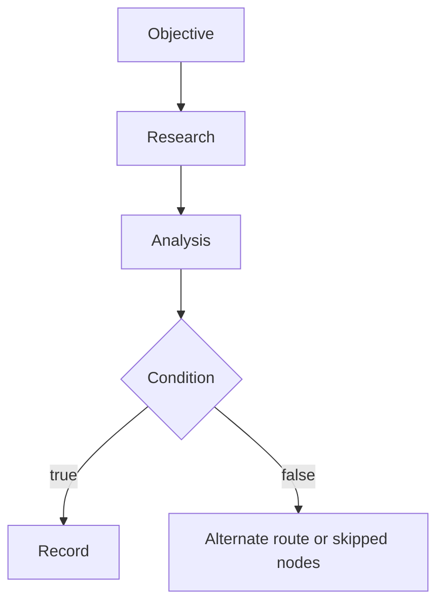

# REAPER

REAPER is a visual workflow system for source-backed research and analysis. Users create directed workflows in the workbench, execute them step by step, and inspect retrieved sources, analysis claims, artifacts, and run logs.

The runtime uses Firecrawl for live web research and one structured OpenAI Responses API call for analysis. Workflows and run snapshots are persisted per signed-in user.

## What it does

- Edit workflows visually: add, configure, connect, move, resize, and remove built-in nodes.
- Use Objective, Research, Analysis, Condition, and Record nodes.
- Route typed values through named ports and nested workflows.
- Branch deterministically and record nodes on unselected paths as skipped.
- Pause, resume, manually step, and recover interrupted persisted runs.
- Enforce a depth limit of 4, a 24-step budget, one search, at most five source pages, and one model call per run.
- Retry once only when a provider failure is clearly transient.
- Validate model citations against source IDs retrieved in that same run.
- Keep legacy browser run history local and labeled as demonstration history.

Adding an executor implementation requires a code change. Arbitrary user code, generic HTTP nodes, unattended scheduling, and multiple model agents are not part of v1.

## Execution



Each server step claims the expected run version before invoking an executor. A stale or concurrent request is rejected before a provider call can be duplicated.

## Requirements

- Node.js 22 (see `.nvmrc`)
- npm
- Firecrawl and OpenAI API keys for live provider-backed runs
- PostgreSQL for durable deployed data
- OAuth broker configuration for deployments outside the managed Grok environment

Local development falls back to in-memory PGLite when `DATABASE_URL` is unset. PGLite data is lost when the server process restarts.

## Configuration

Copy `.env.example` to your private environment manager or local `.env` file. Never commit credentials. `VITE_*` variables are bundled into the browser and must not contain secrets.

| Variable | Required when | Purpose |
| --- | --- | --- |
| `FIRECRAWL_API_KEY` | Running Research | Server-side Firecrawl search |
| `OPENAI_API_KEY` | Running Analysis | Server-side OpenAI Responses API |
| `OPENAI_MODEL` | Optional | Model override; defaults to `gpt-5.4-mini` |
| `DATABASE_URL` | Durable deployment | PostgreSQL connection string |
| `BETTER_AUTH_URL` | External deployment | Public application origin for Better Auth |
| `BETTER_AUTH_SECRET` | External deployment | Session signing secret |
| `GROK_AUTH_ISSUER` | External deployment | OAuth broker issuer |
| `GROK_AUTH_CLIENT_ID` | External deployment | OAuth client ID |
| `GROK_AUTH_CLIENT_SECRET` | External deployment | OAuth client secret |

The managed hosting environment supplies its own auth configuration. Do not copy its credentials into repository files.

## Local development

```bash
npm ci
npm run dev
```

Open [http://localhost:8080](http://localhost:8080). Set `FIRECRAWL_API_KEY` and `OPENAI_API_KEY` in the environment before starting the server to run live research and analysis. Without them, those nodes fail visibly; they do not fabricate sample sources.

The local PGLite database applies migrations from `migrations/*.sql` during startup. With PostgreSQL configured, apply pending migrations using:

```bash
npm run db:migrate
```

## Quality checks

```bash
npm run typecheck
npm run lint
npm test
npm run build:dev
```

GitHub Actions runs these checks for pull requests and pushes to `main`. The production `npm run build` command also applies pending migrations when `DATABASE_URL` is present.

## Architecture

| Path | Responsibility |
| --- | --- |
| `src/components/workbench.tsx` | Visual editor, workflow configuration, run controls |
| `src/lib/engine.ts` | Graph editing, node contracts, legacy workflow upgrade |
| `src/lib/runtime/registry.ts` | Built-in executor registry and port contracts |
| `src/lib/runtime/step.ts` | Execution, routing, branches, retries, limits, nested workflows |
| `src/lib/runtime/providers.server.ts` | Server-only Firecrawl and OpenAI adapters |
| `src/lib/runtime/persistence.server.ts` | Owner-scoped workflow and run persistence |
| `src/lib/runtime/api.ts` | Authenticated server functions |
| `migrations/` | Auth and runtime database schemas |

## Evidence behavior

- A missing credential, empty search result, malformed analysis, or provider failure is recorded as an error.
- Research does not return canned sample records.
- A claim is supported only if it cites one or more source IDs from its own run; unknown IDs leave the claim unsupported.
- Ambiguous provider outcomes are not retried automatically.
- Legacy demonstration artifacts stay outside real persisted run history.

See [CONTRIBUTING.md](CONTRIBUTING.md) for changes and [SECURITY.md](SECURITY.md) for vulnerability reporting.
